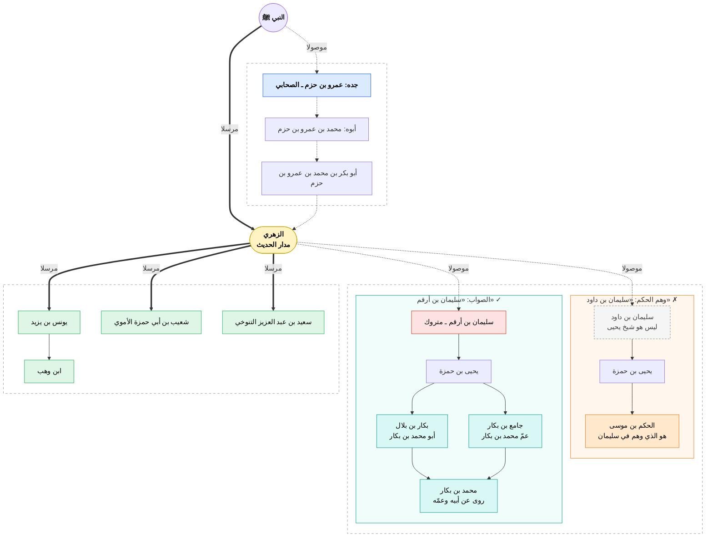
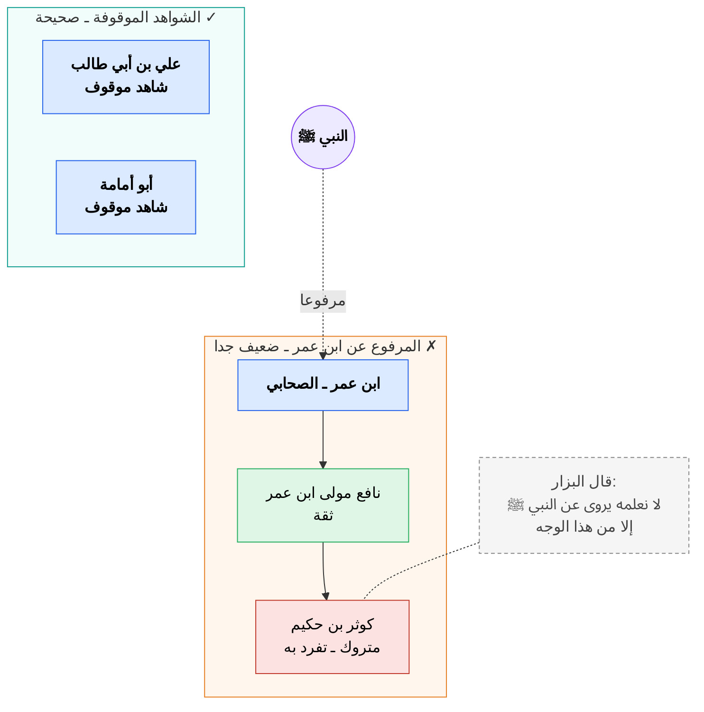

## كتاب الجنايات
**الجنايات:** جمع الجناية، وهي التعدي على البدن بما يوجب قصاصا أو مالا

> [!warning] الجنايات محرمة بالكتاب والسنة والإجماع، والقياس
> **أما الكتاب:**
> - فقوله تعلى: (ولا تقتلوا النفس التي حرّم الله إلا بالحق)
> - وقوله: (ومن يقتل مؤمنا متعمدا فجزآؤه جهنم خالدا فيها وغضب الله عليه ولعنه وأعدّ له عذابا عظيما)
>   
> **أما سنة:**
> - حديث ابن مسعود الآتي
>   
> **أما الإجماع:**
> - فقد نقل ابن المنذر، وابن قدامة، وغيرهما الإجماع على تحريم القتل بغير حق
> 
> **أما القياس:**
> - فمجيء الشريعة بأحكام الجنايات، دليل على كمالها، وأنها جاءت لمصالح العباد يجلب ما ينفعهم، ودفع ما يضرهم، ولولا حكم القصاص، ولولا عقوبة الجناة المفسجين، لأهلك الناس بعضهم بعضا، ولفسد نظام العالم. إذ لا بد من عقاب يرجعهم، ويجعل الجاني نكالا وعظة لمن يريد أن يفعل مثل فعله
   
### الحديث الأول

> [!NOTE] عَنِ ابْنِ مَسْعُودٍ رضي الله عنه قَالَ:
>قَالَ رَسُولُ اللَّهِ ﷺ: «لَا يَحِلُّ دَمُ امْرِئٍ مُسْلِمٍ; يَشْهَدُ أَنْ لَا إِلَهَ إِلَّا اللَّهُ, وَأَنِّي رَسُولُ اللَّهِ, إِلَّا بِإِحْدَى ثَلَاثٍ: الثَّيِّبُ الزَّانِي, وَالنَّفْسُ بِالنَّفْسِ, وَالتَّارِكُ لِدِينِهِ; الْمُفَارِقُ لِلْجَمَاعَةِ». مُتَّفَقٌ عَلَيْهِ

**اسم الراوي:** عبد الله بن مسعود بن غافل الهذلي

**غريب الحديث:**

| الكلمة                          | المعنى                                                                                          |
| ------------------------------- | ----------------------------------------------------------------------------------------------- |
| **لا يحل دم**                   | لا يحل إراقة دمه (هو كناية عن قتله ولو لم يرق دمه)                                              |
| **امرئ**                        | رَجُل                                                                                           |
| **إلا بإحدى ثلاث**              | الباء سببية، أي إلا بسبب إحدى خصال ثلاث                                                         |
| **الثيّب**                      | من وطئ زوجته بنكاح صحيح وهما بالغان عاقلان (وهو وصف يطلق على الذكر والأنثى). وهو عكس البِكر  |
| **الزاني**                      | المراد بقتل الزاني المحصن: رجمه بالحجارة حتى يموت (بالإجماع)                                    |
| **النفس بالنفس**                | من قتل عمدا بغير حق قُتِل بشرطه، وهذا مقيد بحديث عائشة: "**ورجل يقتل مسلما متعمدا، فيقتل**"     |
| **التارك لديه المفارق للجماعة** | الجماعة: جماعة المسلمين أي: فارقهم أو تركهم بالارتداد                                        |

### الحديث الثاني

> [!NOTE] وَعَنْ أَبِي جُحَيْفَةَ قَالَ
> قُلْتُ لَعَلِيٍّ رَضِيَ اللَّهُ عَنْهُمَا: هَلْ عِنْدَكُمْ شَيْءٌ مِنَ الْوَحْيِ غَيْرَ الْقُرْآنِ? قَالَ: لَا، وَالَّذِي فَلَقَ الْحَبَّةَ وَبَرَأَ النِّسْمَةَ, إِلَّا فَهْمٌ يُعْطِيهِ اللَّهُ رَجُلًا فِي الْقُرْآنِ, وَمَا فِي هَذِهِ الصَّحِيفَةِ. قُلْتُ: وَمَا فِي هَذِهِ الصَّحِيفَةِ؟ قَالَ: الْعَقْلُ, وَفِكَاكُ الْأَسِيرِ, وَلَا يُقْتَلُ مُسْلِمٌ بِكَافِرٍ. رَوَاهُ الْبُخَارِيُّ

**اسم الراوي (أبي جحيفة):** وهب بن عبد الله السوائي

**غريب الحديث:**

| الكلمة                                | المعنى                                                                                        |
| ------------------------------------- | --------------------------------------------------------------------------------------------- |
| ه**ل عندكم**                          | الخطاب لعلي والجمع إما لإرادته مع بقية أهل البيت أو للتعظيم                                   |
| **هل عندكم شيء من الوحي غير القرآن**  | سأله عن ذلك لأن جماعة من الشيعة كانوا يزعمون أن عند أهل البيت أشياء من الوحي خصهم النبي ﷺ بها |
| **والذي**                             | الواو للقسم، والغرض منه تأكيد ما تضمنته                                                       |
| **فلق الحبة**                         | الفلق: الشق الحب: ما يكون في السنبل والأكمام                                               |
| **برأ النسمة**                        | برأ: خلق النسمة: الخلْق والنفْس، وهي كل كائن حي فيه روح                                    |
| **إلا فهم يعطيه الله رجلا في القرآن** | الفهم: جودة استعداد الذهن للاستنباط، وحسن تصور المعنى                                         |
| **وما في هذه الصحيفة**                | هي ما يكتب فيه من ورق ونحوه والمراد هنا: الورقة المكتوبة                                   |
| **العقل**                             | الدية                                                                                         |
| **وفكاك الأسير**                      | أي: فيها حكم تخليص الأسير من يد العدو والترغيب في ذلك، وإطلاق أسره من العدو                   |

#### مسائل الحديث
1. أجمعوا على أن المسلم لا يقاد بالحربي
2. واختلفوا في حكم قتل المسلم بالكافر الذمي:

| القول                                                                  | من قال به               | الدليل                                                           |
| ---------------------------------------------------------------------- | ----------------------- | ---------------------------------------------------------------- |
| لا يجوز قتل المسلم بالكافر أبدا (أي سواء كان ذميا أو حربيا أو مستأمنا) | ==الجمهور، وهو الراجح== | حديث الباب                                                       |
| يقتل المسلم بالذمي إذا قتله عمدا                                       | **الحنفية**             | عموم قوله تعالى: (يأيها الذين ءامنوا كتب عليكم القصاص في القتلى) |
| لا يقتل المسلم بالكافر إلا إذا قتله غيلة                               | **المالكية**            | الحديث أن رسول الله ﷺ قتل يوم خيبر مسلما بكافر قتله غيلة         |
3. قتل المسلم بالمستأمن (مثل المسألة السابقة)، لكن فيه وجهان عند الحنفية:
	- قيل يقتل به
	- وقيل لا يقتل به

### الحديث الثالث

> [!NOTE] عَنْ عَمْرِو بْنِ شُعَيْبٍ, عَنْ أَبِيهِ, عَنْ جَدِّهِ رضي الله عنه
> أَنَّ رَجُلًا طَعَنَ رَجُلًا بِقَرْنٍ فِي رُكْبَتِهِ, فَجَاءَ إِلَى النَّبِيِّ - صلى الله عليه وسلم - فَقَالَ: أَقِدْنِي. فَقَالَ: «حَتَّى تَبْرَأَ». ثُمَّ جَاءَ إِلَيْهِ. فَقَالَ: أَقِدْنِي, فَأَقَادَهُ, ثُمَّ جَاءَ إِلَيْهِ. فَقَالَ: يَا رَسُولَ اللَّهِ! عَرِجْتُ, فَقَالَ: «قَدْ نَهَيْتُكَ فَعَصَيْتَنِي, فَأَبْعَدَكَ اللَّهُ, وَبَطَلَ عَرَجُكَ». ثُمَّ نَهَى رَسُولُ اللَّهِ - صلى الله عليه وسلم - «أَنْ يُقْتَصَّ مِنْ جُرْحٍ حَتَّى يَبْرَأَ صَاحِبُهُ». رَوَاهُ أَحْمَدُ, وَالدَّارَقُطْنِيُّ, وَأُعِلَّ بِالْإِرْسَالِ

**اسم الراوي:** 
- **عمرو بن شعيب**
- **أبوه:** شعيب بن محمد بن عبد الله بن عمرو
	- **جده:** عبد الله بن عمرو بن العاص

**غريب الحديث:**

| الكلمة                                            | المعنى                                                                            |
| ------------------------------------------------- | --------------------------------------------------------------------------------- |
| **بقرن**                                          | العظم الناتئ في رأس الحيوان                                                       |
| **طعن**                                           | ضربه بهذا القرن في الركبة                                                         |
| **أقِدني**                                        | أمر من القود، يريد: الاقتصاص من الذي جنى عليه                                     |
| **حتى تبرأ**                                      | انتظر حتى يحصل لك الشفاء                                                          |
| **عرجت**                                          | غمز في رجله                                                                       |
| **قد نهيتك فعصيتني**                              | النهي في قوله: "حتى تبرأ"، والتقدير: لا أقيدك حتى تبرأ                            |
| **فأبعدك الله**                                   | من باب الدعاء على شيء من غير إرادة وقوعه                                          |
| **بطل عرجك**                                      | بطل ما كان له من دية جرحك بتعجلك بالقصاص                                          |
| **نهى رسول الله ﷺ أن يقتص من جرح حتى يبرأ صاحبه** | أي نهى أن يجرح الجارح حتى يبرأ المجروح لأجل أن تعرف الغاية وهل تسري الجناية أم لا |
#### مسائل الحديث
1. حكمة النبي ﷺ في تأخير القصاص أن الجرح ما دام طريا لم يبرأ، ففيه احتمال أن تكون لو سراية ومضاعفات
2. حكم طلب القصاص قبل البرء:

| القول   | من قال به              | الدليل                                                                       |
| ------- | ---------------------- | ---------------------------------------------------------------------------- |
| يحرم    | الجمهور                | حديث الباب                                                                   |
| لا يحرم | الشافعي ورواية عن أحمد | قوله تعالى: (والحرمات قصاص فمن اعتدى عليكم فاعتدوا عليه بمثل ما اعتدى عليكم) |
3. القاعدتان:
   - (**سراية الجناية مضمونة**) لأن ما ترتب على غير المأذون فهو مضمون
   - و(**سراية القود مهدرة**)
### الحديث الرابع

> [!NOTE] عَنْ عُمَرَ بْنِ الْخَطَّابِ قال
> سَمِعْتُ رَسُولَ اللَّهِ ﷺ يَقُولُ: «لَا يُقَادُ الْوَالِدُ بِالْوَلَدِ». رَوَاهُ أَحْمَدُ, وَالتِّرْمِذِيُّ, وَابْنُ مَاجَهْ, وَصَحَّحَهُ ابْنُ الْجَارُودِ وَالْبَيْهَقِيُّ, وَقَالَ التِّرْمِذِيُّ: إِنَّهُ مُضْطَرِبٌ

**غريب الحديث:**

| الكلمة  | المعنى          |
| ------- | --------------- |
| لا يقاد | القَوَد: القصاص |
#### مسألة الحديث (الحكم إذا قتل الوالد ولده)
| القول                                    | من قال به    | الدليل                                                           |
| ---------------------------------------- | ------------ | ---------------------------------------------------------------- |
| لا يُقتل الوالد بولده                    | الجمهور      | حديث الباب                                                       |
| لا يقاد الأب بالابن، إلا أن يضجعه فيذبحه | **المالكية** | حديث عمرو بن شعيب أن رجلا حذف ابنه بالسيف....                    |
| يقتل الوالد بولده                        |              | عموم قوله تعالى: (يأيها الذين ءامنوا كتب عليكم القصاص في القتلى) |

> [!WARNING] تنبيه
> إذا لم يقتل الأب بابنه وجب عليه الدية باتفاق أئمة المذاهب

### الحديث الخامس

> [!NOTE] عَنْ أَنَسِ بْنِ مَالِكٍ
> أَنَّ جَارِيَةً وُجِدَ رَأْسُهَا قَدْ رُضَّ بَيْنَ حَجَرَيْنِ, فَسَأَلُوهَا: مَنْ صَنَعَ بِكِ هَذَا؟ فُلَانٌ. فُلَانٌ. حَتَّى ذَكَرُوا يَهُودِيًّا. فَأَوْمَأَتْ بِرَأْسِهَا, فَأُخِذَ الْيَهُودِيُّ, فَأَقَرَّ, فَأَمَرَ رَسُولُ اللَّهِ - صلى الله عليه وسلم - أَنْ يُرَضَّ رَأْسُهُ بَيْنَ حَجَرَيْنِ. مُتَّفَقٌ عَلَيْهِ, وَاللَّفْظُ لِمُسْلِمٍ

**غريب الحديث:**

| الكلمة            | المعنى                                                 |
| ----------------- | ------------------------------------------------------ |
| **جارية**         | يحتمل أن تكون أمة، ويحتمل أن تكون جارية لكن دون البلوغ |
| **رُضّ**          | دقّ                                                    |
| **بين حجرين**     | أي: وضع رأسها على حجر، ورمى بحجر آخر                   |
| **فأومأت برأسها** | أي أشارت                                               |
#### مسائل الحديث
1. **حكم القصاص بالمثقل**:

| القول                                                                                                          | من قال به                    | الدليل                                                              |
| -------------------------------------------------------------------------------------------------------------- | ---------------------------- | ------------------------------------------------------------------- |
| يجب القصاص بالمثقل                                                                                             | الجمهور                      | حديث الباب                                                          |
| لا قصاص إلا في القتل بالمحدد والقتل بالمثقل لا يعتبر قتل عمد (سواء كان من الحديد أو غيره)، فلا يجب به القود | الشافعي، ورواية عن أبي حنيفة | حديث النعمان بن بشير أن النبي ﷺ قال: "**إن لكل شيء خطأ إلا السيف**" |
2. **حكم قتل الرجل بالمرأة:**
حكوا ابن المنذر والنووي، وابن عبد البر الإجماع على أن القصاص بين المرأة والرجل في النفس إذا كان القتل عمدا. لكن روي عن بعض العلماء خلاف ذلك
- واستدلوا بعموم الآيات الموجبة للقصاص وحديث الباب

> [!warning] تنبيه
> قال الشيخ ابن عثيمين: 
> "فإن قلت: ألا يحتمل أن النبي ﷺ قتله لنقضه العهد؟ 
> فالجواب: لا، لأن النبي ﷺ لو كان قتله للعهد لقتله بالسيف."

3. **حكم قتل القاتل بمثل ما قتل:**

| القول                                                                | من قال به                        | الدليل                                         |
| -------------------------------------------------------------------- | -------------------------------- | ---------------------------------------------- |
| الجاني يُقتل بمثل ما قَتل به (إلا إذا كان محرما مثل السحر، واللِواط) | الجمهور                          | قوله تعالى: (فاعتدوا عليه بمثل ما اعتدى عليكم) |
| لا يكون القصاص إلا بالسيف                                            | أبو حنيفة، والمشهور من مذهب أحمد | حديث: "لا قود إلا بالسيف"                      |
4. في الحديث دليل على جواز العمل بالإشارة في الدعاوى، لكن لا يُعمل بها
5. في قوله (فأقر) دليل على أنه يكفي الإقرار مرة واحدة
### الحديث السادس

> [!NOTE] عَنِ ابْنِ عَبَّاسٍ قال
>  قَالَ رَسُولُ اللَّهِ - صلى الله عليه وسلم: «مَنْ قُتِلَ فِي عِمِّيَّا أَوْ رِمِّيَّا بِحَجَرٍ, أَوْ سَوْطٍ, أَوْ عَصًا, فَعَلَيْهِ عَقْلُ الْخَطَإِ, وَمِنْ قُتِلَ عَمْدًا فَهُوَ قَوَدٌ, وَمَنْ حَالَ دُونَهُ فَعَلَيْهِ لَعْنَةُ اللَّهِ». أَخْرَجَهُ أَبُو دَاوُدَ, وَالنَّسَائِيُّ, وَابْنُ مَاجَهْ, بِإِسْنَادٍ قَوِيٍّ

**اسم الراوي:** عبد الله بن عباس بن عبد المطلب القرشي الهاشمي

**غريب الحديث:**

| الكلمة                           | المعنى                                                                                     |
| -------------------------------- | ------------------------------------------------------------------------------------------ |
| **عِمّيا أو رِمّيا**             | أن يوجد بينهم قتيل يعمى أمره ولا يتبين قاتله                                               |
| **فعليه عقل الخطأ**              | ديته دية القتل الخطأ                                                                       |
| **قُتل عمدا**                    | أن يقصد الجاني من يَعلَمُه آدميا معصوما فيقتله بما يغلب على الظن موته به                   |
| **قود**                          | القصاص                                                                                     |
| **ومن حال دونه فعليه لعنة الله** | أي من حال بين القاتل وبين القود بمنع أولياء المقتول عن قتله بعد طلبهم ذلك، فعليه لعنة الله |
#### مسائل الحديث
1. أجمعوا على أن دية الخطأ تحمله العاقلة (عصبة الجاني)، وأنها مؤجّلة في ثلاث سنين
2. القتل بحجر أو سوط ونحوه إذا لم يعرف القاتل حكمه حكم الخطأ، فتجب الدية دون القصاص
3. تحريم الحيلولة بين أولياء القتيل والقاتل لئلا يقتصوا منه
4. هل ولي القتيل في قتل العمد مخير أم يجب القود:

| القول                                                      | من قال به          | الدليل                                                                  |
| ---------------------------------------------------------- | ------------------ | ----------------------------------------------------------------------- |
| مخير بين القود والدية                                      | الشافية والحنابلة  | حديث أبي هريرة: "ومن قُتل له قتيل فهو بخير النظيرين إما يودى وإما يقاد" |
| يجب القود، ولا ينتقل إلى الدية إلا بالصلح بينه وبين الجاني | الحنفية، والمالكية | حديث الباب                                                              |
### الحديث السابع

> [!NOTE] عَنِ ابْنِ عُمَرَ رَضِيَ اللَّهُ عَنْهُمَا قَالَ
> قتِلَ غُلَامٌ غِيلَةً, فَقَالَ عُمَرُ: «لَوِ اشْتَرَكَ فِيهِ أَهْلُ صَنْعَاءَ لَقَتَلْتُهُمْ بِهِ». أَخْرَجَهُ الْبُخَارِيُّ

**اسم الراوي:** عبد الله بن عمر بن الخطاب

**غريب الحديث:**

| الكلمة   | المعنى                                  |
| -------- | --------------------------------------- |
| **غيلة** | أن يُخدع ويُقتل في موضع لا يراه فيه أحد |
#### مسائل الحديث
1. تُقتل الجماعة بالواحد إذا كان فعل كل واحد منهم صالحا للقتل له لو انفرد عند الجمهور
2. **هل يقتل من قتل غيلة قصاصا أم حدا؟**

| القول                                          | من قال به | الدليل                                                                |
| ---------------------------------------------- | --------- | --------------------------------------------------------------------- |
| يقتل قصاصا، فلولي الدم الخيار بين القود والدية | الجمهور   | قوله تعالى: (ومن قتل مظلوما فقد جعلنا لوليه سلطانا فلا يسرف في القتل) |
| يقتل حدا،                                      | المالكية  | أثر الباب                                                             |
# باب الديات
**معنى الدية في الشرع:** المال المؤدى إلى المجني عليه، أو وليه بسبب جناية

> [!NOTE] الأصل في وجوب الدية الكتاب، والسنة، والإجماع
> **الكتاب:** قوله تعالى: (ومن قتل مؤمنا خطئا فتحرير رقبة مؤمنة ودية مسلمة إلى أهله إلا أن يصدقوا)
> **السنة:** أحاديث الباب
> **الإجماع:** قال ابن قدامة: أجمع أهل العلم على وجوب الدية في الجملة

### الحديث الثامن

> [!NOTE] عَنْ أَبِي بَكْرٍ بْنِ مُحَمَّدٍ بْنِ عَمْرِوِ بْنِ حَزْمٍ, عَنْ أَبِيهِ, عَنْ جَدِّهِ
> أَنَّ النَّبِيَّ - صلى الله عليه وسلم - كَتَبَ إِلَى أَهْلِ الْيَمَنِ ... فَذَكَرَ الْحَدِيثَ, وَفِيهِ: «أَنَّ مَنِ اعْتَبَطَ مُؤْمِنًا قَتْلًا عَنْ بَيِّنَةٍ, فَإِنَّهُ قَوَدٌ, إِلَّا أَنْ يَرْضَى أَوْلِيَاءُ الْمَقْتُولِ, وَإِنَّ فِي النَّفْسِ الدِّيَةَ مِائَةً مِنْ الْإِبِلِ, وَفِي الْأَنْفِ إِذَا أُوعِبَ جَدْعُهُ الدِّيَةُ, وَفِي اللِّسَانِ الدِّيَةُ, وَفِي الشَّفَتَيْنِ الدِّيَةُ, وَفِي الذَّكَرِ الدِّيَةُ, وَفِي الْبَيْضَتَيْنِ الدِّيَةُ, وَفِي الصُّلْبِ الدِّيَةُ, وَفِي الْعَيْنَيْنِ الدِّيَةُ, وَفِي الرِّجْلِ الْوَاحِدَةِ نِصْفُ الدِّيَةِ, وَفِي الْمَأْمُومَةِ ثُلُثُ الدِّيَةِ, وَفِي الْجَائِفَةِ ثُلُثُ الدِّيَةِ, وَفِي الْمُنَقِّلَةِ خَمْسَ عَشْرَةَ مِنَ الْإِبِلِ, وَفِي كُلِّ إِصْبَعٍ مِنْ أَصَابِعِ الْيَدِ وَالرِّجْلِ عَشْرٌ مِنَ الْإِبِلِ, وَفِي السِّنِّ خَمْسٌ مِنَ الْإِبِلِ وَفِي الْمُوضِحَةِ خَمْسٌ مِنَ الْإِبِلِ, وَإِنَّ الرَّجُلَ يُقْتَلُ بِالْمَرْأَةِ, وَعَلَى أَهْلِ الذَّهَبِ أَلْفُ دِينَارٍ». أَخْرَجَهُ أَبُو دَاوُدَ فِي «الْمَرَاسِيلِ» وَالنَّسَائِيُّ, وَابْنُ خُزَيْمَةَ, وَابْنُ الْجَارُودِ, وَابْنُ حِبَّانَ, وَأَحْمَدُ, وَاخْتَلَفُوا فِي صِحَّتِهِ

**اسم الراوي:** 
- **أبو بكر بن محمد**
- عن **أبيه:** محمد بن عمرو
- عن **جده (الراوي):** عمرو بن حزم الأنصاري 

==**التخريج:**==
روي الحديث موصولا ومرسلا

> [!tip] مفتاح الشجرة
> - الخط المنقّط: الوجه الموصول (المرجوح)
> - الخط العريض: الوجه المرسل (الراجح)

==قال ابن تيمية: (وهذا الكتاب مشهور مستفيض عند أهل العلم، وهو عند كثير منهم أبلغ من خبر الواحد العدل المتصل وهو صحيح بإجماعهم)==

**غريب الحديث:**

| الكلمة                                            | المعنى                                                                                                                                                                             |
| ------------------------------------------------- | ---------------------------------------------------------------------------------------------------------------------------------------------------------------------------------- |
| **كتب**                                           | أمر بأن يُكتب                                                                                                                                                                      |
| **اعتبط**                                         | أي قتله بلا جناية كانت منه ولا جريرة توجب قتله، فإن القاتل يقاد به ويقتل (كل من مات بغير علة)                                                                                      |
| **بيّنة**                                         | الحجة الواضحة، والمراد: الشهود على قتله أو ثبوته بإقراره                                                                                                                           |
| **قود**                                           | القصاص                                                                                                                                                                             |
| **إلا أن يرضى أولياء المقتول**                    | بقبول الدية أو يقع منهم العفو                                                                                                                                                      |
| **وإن في النفس الدية: مائة من الإبل**             | **بالإجماع**                                                                                                                                                                       |
| **وفي الأنف إذا أوعب جدعه الدية**                 | **بالإجماع** أوعِبَ: قطع جميع أنفه                                                                                                                                              |
| **وفي اللسان الدية**                              | **بالإجماع** (إلا ما انفرد به قتادة والنخعي)، وأجمعوا أن في لسان الأخرس حكومة.                                                                                                     |
| **وفي الشفتين الدية**                             | الجزء اللحمي الظاهر الذي يستر الأسنان **بالإجماع**                                                                                                                              |
| **وفي الذكر الدية**                               | **بالإجماع** وانفرد قتادة فقال: في ذكر الذي لا يأتي النساء ثلث غيره                                                                                                                |
| **وفي البيضتين الدية**                            | أي: الخصيتين، وفي الوحدة نصف الدية **بالإجماع**                                                                                                                                 |
| **وفي الصلب الدية**                               | أي العمود الفقري **بالإجماع** وانفرد ابن الزبير                                                                                                                                 |
| **وفي العينين الدية**                             | **بالإجماع** وفي الواحدة، نصف الدية                                                                                                                                                |
| **وفي الرجل الواحدة نصف الدية**                   | **بالإجماع**                                                                                                                                                                       |
| **وفي المأمومة ثلث الدية**                        | المأمومة: الشجة التي تصل إلى أم الدماغ (وهي جلدة فوق الدماغ)  **بالإجماع** إلا ما انفرد به مكحول فقال: في العمد: ثلثا الدية في الخطأ: ثلث الدية  وليس فيها قود   |
| **وفي الجائفة ثلث الدية**                         | الطعنة التي تصل إلى باطن الجوف من بطن أو ظهر أو صدر أو غير ذلك  **بالإجماع** إلا ما انفرد به مكحول فقال: في العمد: ثلثا الدية في الخطأ: ثلث الدية  وليس فيها قود |
| **وفي المنقِّلة خمس عشرة من الإبل**               | الشجة التي تكسر العظم، وتنقله عن محله  **بالإجماع** وليس فيها قود وروي أن ابن الزبير أقاد منها                                                                               |
| **وفي كل إصبع من أصابع اليد والرجل عشر من الإبل** | وهو قول الجمهور                                                                                                                                                                    |
| **وفي السن خمس من الإبل**                         | **بالإجماع**                                                                                                                                                                       |
| **وفي الموضحة خمس من الإبل**                      | الشجة التي توضح عظم الرأس، أو الوجه وتبدي بياضه، ولا تكسره  **بالإجماع**                                                                                                     |
| **وعلى أهل الذهب ألف دينار**                      | قدر الدية بالذهب: ألف دينار، أي 4250 غراما                                                                                                                                         |

### مسائل الحديث
1. اختلفوا في الدية في الصلب إذا كسر فلم يجبر:

| القول                        | من قال به | الدليل                                                        |
| ---------------------------- | --------- | ------------------------------------------------------------- |
| فيه الدية                    | الجمهور   | حديث الباب                                                    |
| ليس فيه دية إلا أن يذهب مشيه | الشافعية  | لأنه عضو ولم تذهب منفعته، فلم تجب فيه دية كاملة كسائر الأعضاء |
2. الشجاج تنقسم إلى قسمين:
- ما ليس فيه دية مقدرة، وإنما فيه حكومة: وهي خمسة أنواع:
	1. **الحارصة**: التي تحرص (تشقه قليلا ولا تدميه) الجلد
	2. **البازلة** (**الدامية**): التي تشق الجلد ويسيل الدم
	3. **الباضعة**: التي تشق اللحم
	4. **المتلاحمة**: التي تشق اللحم، وتغوص فيه
	5. **السِّمحاق**: ما بينها وبين العظم قشرة رقيقة
- ما فيه دية مقدرة، وهي خمسة أنواع:
	1. **الموضحة**
	2. **الهاشمة**: التي تهشم العظم وتكسره، وفيه عشر من الإبل
	3. **المنقِّلة**
	4. **المأمومة**
	5. **الدامغة**: التي تصل جلدة الدماغ وتخرقه، وفيها ثلث الدية
# باب دعوى الدم والقسامة
**القسامة:** أيمان مكررة في دعوى قتل معصوم
وكانت معروفة في الجاهلية يحكم بها الناس، فأقرها الإسلام على ما كانت فيه
### الحديث التاسع

> [!NOTE] عَنْ سَهْلِ بْنِ أَبِي حَثْمَةَ, عَنْ رِجَالٍ مِنْ كُبَرَاءِ قَوْمِهِ
> أنَّ عَبْدَ اللَّهِ بْنَ سَهْلٍ ومُحَيِّصَةَ بْنَ مَسْعُودٍ خَرَجَا إِلَى خَيْبَرَ مِنْ جَهْدٍ أَصَابَهُمْ, فَأُتِيَ مَحَيِّصَةُ فَأُخْبِرَ أَنَّ عَبْدَ اللَّهِ بْنِ سَهْلِ قَدْ قُتِلَ, وَطُرِحَ فِي عَيْنٍ, فَأَتَى يَهُودَ, فَقَالَ: أَنْتُمْ وَاللَّهِ قَتَلْتُمُوهُ. قَالُوا: وَاللَّهِ مَا قَتَلْنَاهُ, فَأَقْبَلَ هُوَ وَأَخُوهُ حُوَيِّصَةُ وَعَبْدُ الرَّحْمَنِ بْنُ سَهْلٍ, فَذَهَبَ مُحَيِّصَةُ لَيَتَكَلَّمَ, فَقَالَ رَسُولُ اللَّهِ - صلى الله عليه وسلم: «كَبِّرْ كَبِّرْ» يُرِيدُ: السِّنَّ, فَتَكَلَّمَ حُوَيِّصَةُ, ثُمَّ تَكَلَّمَ مُحَيِّصَةُ, فَقَالَ رَسُولُ اللَّهِ - صلى الله عليه وسلم: «إِمَّا أَنْ يَدُوا صَاحِبَكُمْ, وَإِمَّا أَنْ يَأْذَنُوا بِحَرْبٍ». فَكَتَبَ إِلَيْهِمْ فِي ذَلِكَ كِتَابًا. فَكَتَبُوا: إِنَّا وَاللَّهِ مَا قَتَلْنَاهُ, فَقَالَ لِحُوَيِّصَةَ, وَمُحَيِّصَةُ, وَعَبْدِ الرَّحْمَنِ بْنَ سَهْلٍ: «أَتَحْلِفُونَ, وَتَسْتَحِقُّونَ دَمَ صَاحِبَكُمْ?» قَالُوا: لَا. قَالَ: «فَتَحْلِفُ لَكُمْ يَهُودُ?» قَالُوا: لَيْسُوا مُسْلِمِينَ فَوَدَاهُ رَسُولَ اللَّهِ - صلى الله عليه وسلم - مِنْ عِنْدِهِ, فَبَعَثَ إِلَيْهِمْ مَائَةَ نَاقَةٍ. قَالَ سَهْلٌ: فَلَقَدْ رَكَضَتْنِي مِنْهَا نَاقَةٌ حَمْرَاءُ. مُتَّفَقٌ عَلَيْهِ

**اسم الراوي:** سهل بن عامر الأنصاري

**غريب الحديث:**

| الكلمة                          | المعنى                                                                              |
| ------------------------------- | ----------------------------------------------------------------------------------- |
| **محيّصة**                      | ابن مسعود ين كعب                                                                    |
| **خيبر**                        | مدينة تارخية شمال المدينة                                                           |
| **جهد**                         | المشقة وضيق العيش                                                                   |
| **طرح في عين**                  | ألقي بعد قتله في بئر صغير                                                           |
| **حويصة**                       | ابن مسعود                                                                           |
| **كبر كبر**                     | أي: قدّم الأسن في الكلام                                                            |
| **إما أن يدوا صاحبكم**          | تؤدي لكم اليهود الدية                                                               |
| **إما أن يأذنوا بحرب**          | الأذان: الإعلام أي: يعلمهم بالحرب                                                |
| **فكتب إليهم في ذلك**           | أي: كتب رسول الله ﷺ بذكر ما ادّعي به عليهم، وإنما كتب إليهم في ذلك لينظر ماذا عندهم |
| **أتحلفون وتستحقون دم صاحبكم**  | الهمزة للاستفهام                                                                    |
| **قالو: لا**                    | بينوا سبب امتناعهم عن الحلف (قالوا وكيف نحلف ولم نشهد ولم نر)                       |
| **فتحلف لكم يهود**              | في رواية: (فتبرئكم يهود بخمسين يمينا)                                               |
| **ليسوا بمسلمين**               | فلا يؤمن من أن يحلفوا وهم كاذبون                                                    |
| **فوداه رسول الله ﷺ من عنده**   | أي دفع ديته، وفعل ذلك قطعا للنزاع                                                   |
| **فلقد ركضتني منها ناقة حمراء** | أي: رفستني برجلها والمراد أنه ضبط الحديث وحفظه حفظا بليغا                        |
#### مسائل الحديث
1. أجمعوا على أنه لا يجب قصاص ولا دية بمجرد الدعوى حتى تقترن بها شبهة يغلب الظن بها
2. واختلفوا في الشبهة المعتبرة الموجبة للقسامة، منها:
	   - العداوة الظاهرة
	   - ووجود المتهم عند المقتول، أو قريبا منه، أو آتيا من جهته، ومعه آلة القتل، وعليه أثره من لطخ دم وغيره
3. دعوى القسامة خالفت سائر الدعوى بأمور:
	- اليمين توجهت على المدعي، أما بقية الدعاوى فالبينة على المدعي، واليمين على المدعى عليه
	- الأيمان كررت، والأصل أن الأيمان لا تكرر
	- المدعي يحلف على شيء لم يره، بل معتمدا على غلبة الظن
4. الأيمان توزع عليهم بحسب الإرث
5. هل يجب القصاص بالقسامة إذا كان القتل عمدا؟

| القول                         | من قال به                     | الدليل                                              |
| ----------------------------- | ----------------------------- | --------------------------------------------------- |
| يجب                           | الجمهور                       | قوله ﷺ (يُقسم خمسون منكم على رجل منهم فيدفع برمّته) |
| لا توجب القصاص، بل توجب الدية | أبي حنيفة، والشافعي في الجديد | قوله ﷺ (إما أن يدوا صاحبكم، وإما أن يأذنو بحرب)     |
6. ==البداءة في القسامة بيمين المدعي عند الجمهور، وهو الراجح، خلافا للحنفية==

# باب قتال أهل البغي
**البغي اصطلاحا:** الخارجون على طاعة الإمام بتأويل سائغ ولهم شوكة ومنعة
### الحديث العاشر

> [!NOTE] عَنِ ابْنِ عُمَرَ رَضِيَ اللَّهُ عَنْهُمَا قَالَ
> قَالَ رَسُولُ اللَّهِ ﷺ: «هَلْ تَدْرِي يَا ابْنَ أُمِّ عَبْدٍ, كَيْفَ حُكْمُ اللَّهِ فِيمَنْ بَغَى مِنْ هَذِهِ الْأُمَّةِ?» , قَالَ: اللَّهُ وَرَسُولُهُ أَعْلَمُ. قَالَ: «لَا يُجْهَزُ عَلَى جَرِيحِهَا, وَلَا يُقْتَلُ أَسِيرُهَا, وَلَا يُطْلَبُ هَارِبُهَا, وَلَا يُقْسَمُ فَيْؤُهَا». رَوَاهُ الْبَزَّارُ وَالْحَاكِمُ وَصَحَّحَهُ فَوَهِمَ; فَإِنَّ فِي إِسْنَادِهِ كَوْثَرَ بْنَ حَكِيمٍ, وَهُوَ مَتْرُوكٌ

**اسم الراوي:** عبد الله بن عمر

**التخريج:**
عن كوثر بن حكيم، عن نافع، عن ابن عمر به
- **إسناده ضعيف جدا** من أجل كوثر، فهو **متروك**
- قال البزار: (وهذا الحديث لا نعلمه يروى عن النبي ﷺ إلا من هذا الوجه)
- وقد **صح** من حديث علي بن أبي طالب، وأبي أمامة **موقوفا**

**غريب الحديث:**

| الكلمة         | المعنى                                                                                                                               |
| -------------- | ------------------------------------------------------------------------------------------------------------------------------------ |
| **ابن أم عبد** | عبد الله بن مسعود                                                                                                                    |
| **لا يُجهز**   | يقال: جَهَزتُ على الجريح إذا أتممت عليه وأسرعت قتله                                                                                  |
| **فيؤها**      | أصل الفيء: الرجوع ثم أطلق على: ما حصل للمسلمين من أموال الكفار من غير حرب ولا جهاد  والمعنى: ما غنم من سلاح ونحوه، فلا تقسم |
#### مسائل الحديث
1. أجمعوا على قتال البُغاة لقوله تعالى (فقاتلوا التي تبغي) الآية، لكن يتعين أولا دعاؤهم إلى الرجوع، وإرسال من يدفع عنهم الشبهات
2. وأجمعوا على تحريم غنيمة أموالهم، وسبي ذريتهم
3. دل الحديث على أنه لا يقتل الأسير لأنه مسلم، فحرمته باقية، وإنما جاز قتالهم لدفع شرهم
### الحديث الحادي عشر

> [!NOTE] عَنْ عَرْفَجَةَ بْنِ شُرَيْحٍ
> سَمِعْتُ رَسُولَ اللَّهِ - صلى الله عليه وسلم - يَقُولُ: «مَنْ أَتَاكُمْ وَأَمَرَكُمْ جَمِيعٌ, يُرِيدُ أَنْ يُفَرِّقَ جَمَاعَتَكُمْ, فَاقْتُلُوهُ». أَخْرَجَهُ مُسْلِمٌ

**غريب الحديث:**

| الكلمة           | المعنى                                                                                                           |
| ---------------- | ---------------------------------------------------------------------------------------------------------------- |
| **من أتاكم**     | وفي رواية: "كائنا من كان"  يعني: أيُ شخص كان، شريفا أو وضيعا، عالما أو جاهلا                               |
| **أمرُكم جميع**  | كلمتكم مجتمعة على إمام واحد                                                                                      |
| **يفرق جماعتكم** | وفي رواية: يشق عصاكم  أي: يفرّق جماعتكم كما تفرق العصاة المشقوقة، وهو عبارة عن اختلاف الكلمة وتنافر النفوس |
| **فاقتلوه**      | إن لم يندفع شره إلا بالقتل، وإلا فإن الواجب في حقه أن يُنهي أولا عن ذلك، فإن انتهى فذاك، وإلا قوتل               |
#### مسائل الحديث
1. وجوب السمع والطاعة لولي أمر المسلمين ما أمر بالطاعة، وتحريم الخروج عليه  
# باب قتال الجاني وقتل المرتد
**المرتد اصطلاحا:** الذي يكفر بعد إسلامه طوعا
### الحديث الثاني عشر

> [!NOTE] عَنْ عِمْرَانَ بْنِ حُصَيْنٍ رَضِيَ اللَّهُ عَنْهُمَا قَالَ
> قَاتَلَ يُعْلَى بْنُ أُمَيَّةَ رَجُلًا, فَعَضَّ أَحَدُهُمَا صَاحِبَهُ, فَنَزَعَ ثَنِيَّتَهُ, فَاخْتَصَمَا إِلَى النَّبِيِّ - صلى الله عليه وسلم - فَقَالَ: «أَيَعَضُّ أَحَدُكُمْ أَخَاهُ كَمَا يَعَضُّ الْفَحْلُ? لَا دِيَةَ لَهُ». مُتَّفَقٌ عَلَيْهِ, وَاللَّفْظُ لِمُسْلِمٍ

**اسم الراوي:** (عمران بن حصين): هو ابن عُبيد بن خلفل الخزاعي
- (يعلى بن أمية بن أبي عبيدة بن همام التميمي): وهو يعلى بن مُنية (وهي أمه، وقيل جدته)
**غريب الحديث:**

| الكلمة                            | المعنى                                                           |
| --------------------------------- | ---------------------------------------------------------------- |
| **ثنيته**                         | إحدى الأسنان الأربع التي في مقدم الفم                            |
| **أيعض أحدكم أخاه كما يعض الفحل** | المراد من الاستفهام الإنكار، والتوبيخ                            |
| **الفحل**                         | الذكر من الإبل (وهو المراد)  ويطلق على غيره من ذكور الدواب |
#### مسائل الحديث
1. كانت هذه القصة في غزوة تبوك
2. اختلفوا في تعيين المبهم في الحديث:

| القول                                        | من قال به        | الدليل                                                                |
| -------------------------------------------- | ---------------- | --------------------------------------------------------------------- |
| العاض: هو يعلى بن أمية المعضوض: أجير يعلى | العراقي، ابن حجر | ما جاء في بعض طرق الحديث عند مسلم: "أن أجيرا ليعلى بن منية عض..."  |
| العاض: أجير يعلى المعضوض: يعلى            | القرطبي          |                                                                       |
3. دل على أن العاض معتد صائل(هو: الاستعلاء على الغير بغير وجه الحق) على المعضوض، وأن للمعضوض الدفاع عن نفسه، ولا يترتب على دفاعه ضمان ما يتلف بسببه، لأنه مشروع مأذون فيه، **وما ترتب على المأذون فهو غير مضمون**
4. يدل على قاعدة ذكر ابن رجب: (**من أتلف شيئا لدفع أذاه له لم يضمنه، وإن أتلفه لدفع أذاه به ضمنه**)
5. اختلفوا في الضمان بالدية في العض:

| القول   | من قال به               | الدليل                                         |
| ------- | ----------------------- | ---------------------------------------------- |
| لا يضمن | ==الجمهور، وهو الراجح== | حديث الباب                                     |
| يضمن    | مالك                    | حديث عمرو بن حزم، وفيه "وفي السن خمس من الإبل" |
==🟢قال ابن بطال: لو بلغ مالكا هذا الحديث لما خالفه==
6. من فوائد الحديث: 
	   - التحذير من الغضب
	   - جواز تشبيه فعل الآدمي بفعل البهيمة إذا وقع في مقام التنفير عن مثله
### الحديث الثالث عشر

> [!NOTE] عَنْ الْبَرَاءِ بْنِ عَازِبٍ قال
> قَضَى رَسُولُ اللَّهِ - صلى الله عليه وسلم - أَنَّ حِفْظَ الْحَوَائِطِ بِالنَّهَارِ عَلَى أَهْلِهَا, وَأَنْ حِفْظَ الْمَاشِيَةِ بِاللَّيْلِ عَلَى أَهْلِهَا, وَأَنَّ عَلَى أَهْلِ الْمَاشِيَةِ مَا أَصَابَتْ مَاشِيَتُهُمْ بِاللَّيْلِ. رَوَاهُ أَحْمَدُ, وَالْأَرْبَعَةُ إِلَّا التِّرْمِذِيُّ, وَصَحَّحَهُ ابْنُ حِبَّانَ وَفِي إِسْنَادِهِ اِخْتِلَافٌ

**اسم الراوي:** البراء بن عازب بن الحارث بن عدي الأنصاري

**غريب الحديث:**

| الكلمة      | المعنى                                   |
| ----------- | ---------------------------------------- |
| **الحوائط** | البستان، وسمي بذلك لأنه يحوط عليها غالبا |
#### مسائل الحديث
1. دل الحديث على أن ما أتلفته البهيمة من الحوائط في الليل من ثمر أو زرع فهو على أهلها، لأنهم هم الذين فرطوا بتركها مرسلة في الليل في وقت لم تجر به العادة، وأن ما أتلفته التهيمة بالنهار من الحوائط فليس فيه ضمان، لأن المسؤول عن حفظ الحوائط هم أهلها
2. اعتبار العرف والعمل به، 
	- لأن العرف أن أصحاب الحوائط والبساتين يحفظونها بالنهار، وأصحاب المواشي يسرحونها بالنهار
3. اختلفوا في ضمان ما أفسدته المواشي من الزرع في الليل أو النهار:

| القول                                                                                                                  | من قال به               | الدليل                               |
| ---------------------------------------------------------------------------------------------------------------------- | ----------------------- | ------------------------------------ |
| على مالك المواشي ضمان ما أفسدته ليلا دون ما كان بالنهار (إذا لم تكن يد أحد عليها، فإن كان صاحبها معها عليه ضمان التلف) | ==الجمهور، وهو الراجح== | حديث الباب                           |
| لا ضمان على أصحاب البهائم مطلقا، إلا يكون راكبا، أو سائقا، أو قائدا                                                    | أبو حنيفة               | حديث أبي هريرة: "العجماء جرحها جبار" |
| لا ضمان فيما أتلفت البهيمة سواء كانت منفردة أو معها أحج، إلا إذا كان الفعل منسوبا إليه بأن حملها على ذلك الفعل         | الظاهرية                | عموم حديث أبي هريرة                  |

### الحديث الرابع عشر

> [!NOTE] عَنِ ابْنِ عَبَّاسٍ رَضِيَ اللَّهُ عَنْهُمَا قَالَ
> قَالَ رَسُولُ اللَّهِ - صلى الله عليه وسلم: «مَنْ بَدَّلَ دِينَهُ فَاقْتُلُوهُ». رَوَاهُ الْبُخَارِيُّ

**غريب الحديث:**

| الكلمة                  | المعنى                                                                                                                                                                                                                             |
| ----------------------- | ---------------------------------------------------------------------------------------------------------------------------------------------------------------------------------------------------------------------------------- |
| **من بدل دينه فاقتلوه** | صيغة عموم تشمل الذكر (بالإجماع)، والأنثى (فيه خلاف، كما سيأتي)  قال ابن حجر: (قوله "من" عام يخص منه من بدله في الباطن ولم يثبت عليه ذلك في الظاهر فإنه تجري عليه أحكام الظاهر، ويستثنى منه من بدل دينه في الظاهر مع الإكراه) |
#### مسائل الحديث
1. أجمعوا على وجوب قتل المرتد
2. قتل المرتد إلى الإمام حرا كان أو عبدا عند الجمهور (خلافا للشافعي في أحد الوجهين في العبد، فإن لسيده قتله)
3. حكم قتل المرأة المرتدة:

| القول                             | من قال به               | الدليل                                                      |
| --------------------------------- | ----------------------- | ----------------------------------------------------------- |
| تقتل                              | ==الجمهور، وهو الراجح== | حديث الباب                                                  |
| لا تقتل، وتجبر على الإسلام بالحبس | الحنفية                 | حديث ابن عمر، وفيه "نهى رسول الله ﷺ عن قتل النساء والصبيان" |

<!-- alkunnash-note-id:39443f8d-b889-494f-80ff-53fa690f8273 -->
